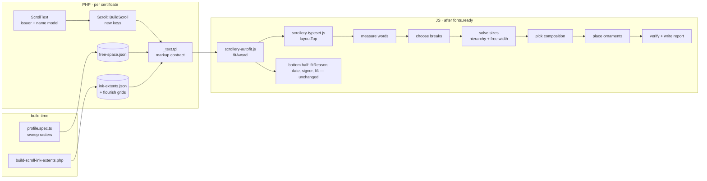

# Scrollery typeset engine: the top of the certificate

**Status:** design, awaiting approval · **Date:** 2026-10-25 · **Branch:** `scrollery`
**Evidence:** the 50-certificate review at https://claude.ai/artifact/KQFTsuw3D4Mhk8SNqbGKhx
(private to the owner). The frozen case list is reproduced in
`tools/scroll-sweep/corpus/review-2026-10-25.json` (committed by task T1).

This document is written for the builders who will implement it: Sonnet subagents
working task by task from the companion plan
`docs/superpowers/plans/2026-10-25-scrollery-typeset-engine.md`. It states what to build
and why, the interfaces between the parts, the algorithms with their starting
constants, and how "done" is measured. Where it says **MUST**, deviate only after
writing down why in the task report.

---

## 1. Why this exists

The top half of every Scrollery certificate says: *Amtgard and the {Place} presents
{Name} with their {Nth} {Award}.* A seeded random sample of 50 real combinations (real
kingdom and park names, personas from 3 to 100 characters, 13 designs, all ten hands),
rendered in Chromium through the real template, showed that this block fails in ways
that are systematic, not cosmetic:

| # | Defect | Measured |
|---|---|---|
| D1 | The recipient is not the largest name on their own certificate. Three unrelated rules set the three big sizes: a character-count formula for the name (`_text.tpl:122`), a flat 1.5em for the award (`scrollery.css:870`), a reciprocal formula for the place (`_text.tpl:113`). Autofit only shrinks (`scrollery-autofit.js:471`). | 31/50 award > name; 14/50 place ≥ name; every persona ≥ 23 characters (1,959 players) starts below the award |
| D2 | The issuing name swings from 16pt to 41pt in one slot. Kingdom names arrive as a whole phrase ("The Kingdom of the Wetlands") squeezed into line two's ~1,150px box; park names arrive short and are inflated. | kingdom median 21pt, park median 37pt; 47% of ladder awards are kingdom-issued |
| D3 | The right swash (`#RightTextFlourish`) is sized in the em of line two's paragraph, not of the name, and its curl runs along the name's baseline. Its head rises to line one's height at the right edge. | curl crosses the kingdom name on 25/25 kingdom certificates; title "of" into swash head on 5/25 park certificates |
| D4 | Long titles wrap into a three-line zigzag ("Amtgard and the / Principality of / the Crimson Sands") with the bottom swash under line two. | c11, c14, x3 |
| D5 | The fitter predicts instead of measuring. The one-line tier solves to exactly 100% of the column and the browser wraps it; the 2- and 3-line tiers assume 92% packing and never check. Breaks come from `text-wrap: balance` alone. | 9 boundary wraps; 3 cases printed more lines than planned; breaks after "of", inside quoted nicknames, single words alone |
| D6 | The column is treated as a rectangle. Plates intrude into it at the name and award heights (hunter archers, garber needle, zodiac glyphs, lion heads, phoenixes, smith corner knots). `ink-extents.json` has one box per image. | 5 overlaps, 6 near-misses |
| D7 | Vertical spacing is whatever `flex-grow` leaves; long content triggers pass 3, which scales the whole certificate. | large gaps on c10/c19/c20/c37/c39; page scaled on c32 (0.94), c50 (0.96) |
| D8 | Text reaches the layout unparsed: doubled articles ("the Shire of The Everglade Sentinels", 11 of 342 active parks start with "The"), kingdom phrases never split, honorific stacks and epithets ignored. | c37, c45; c41, c18, c27 |

The current code is a long series of individually reasoned patches. Each patch fixed a
measured symptom, and the comments say so honestly. But the parts do not know about
each other: sizes, line breaks, ornaments and artwork are each decided without the
others. More patches cannot fix that. This design replaces the top-half sizing and
breaking with one engine that knows all four.

## 2. Goals, non-goals, anti-goals

**Goals**

- G1. The recipient's name is always the most prominent text in the top half. The award
  line is second, the place third, and the connecting words smallest. This is enforced
  as a constraint, not left to emerge.
- G2. Kingdom-issued and park-issued certificates look alike. The place name gets the
  same treatment whichever kind of body issued it.
- G3. No text in the top half touches ornament ink or artwork ink, by construction, and
  this is verified on pixels by the existing sweep.
- G4. Line breaks are typographically sound: phrase-aware, balanced, and no protected
  span (quoted nickname, parenthetical) ever split. The number of lines printed is the
  number planned. Explicit lines make that true by construction.
- G5. Sizes can grow as well as shrink, within ranges set per role. Hands differ only
  through their measured widths. A per-hand multiplier is calibration latitude (T14), not
  a requirement.
- G6. The top half has a planned vertical rhythm. It never makes the whole page shrink.
- G7. The composer preview and the print surface produce the same layout from the same
  text.
- G8. All of the above is proven on a fixed corpus (the 54 review cases), on a fresh
  seeded random corpus, and on the existing sweep matrix. Every gate is automated except
  the final visual sign-off.

**Non-goals**

- The citation, flavour line and signature block (the bottom half). They keep their
  current fitters (`fitReason`, date/signer `fitInline`, `liftSignature`). The open C∩A
  sign-and-date family documented in `docs/scrollery-ink-collision-results.md` §4
  remains open. The free-space data built here is designed so a later project can feed
  it to the citation band.
- New artwork. Every plate and flourish file stays byte-identical.
- Server-side font metrics. Layout stays in the browser; the server sends a sensible
  first guess for a render with no JavaScript.
- Truncated personas in the data ("…a murdered cla"). That is a 100-character column
  limit, not a layout problem.

**Anti-goals: failure even if every test passes**

- The default look changes for certificates that currently look right. A short park
  name with a short persona (c22, c26) must still come out as today's Classic
  composition with the versal, the swashes and the right-hung place name.
- The engine ever deletes or hides recipient or award text to make room. Shrinking,
  breaking or switching composition are the only tools.
- A certificate prints with text on top of a figure (archer, lion, needle).
- The composer preview disagrees with the print.

## 3. Decisions taken (the designer's calls)

The owner did not state a position on these. Each is the designer's call and is
recorded so it can be overruled before building.

1. **Classic stays the default composition.** When Classic cannot fit with clearance, the
   engine switches automatically to a new **Centered** composition (§6.5). An officer
   can force either with a new `&heading=classic|centered` print parameter. A third
   "Ribbon" composition, shown in the review, is deferred.
2. **Kingdom names are split into rank word and proper name** at the text-model layer:
   "The Kingdom of the Wetlands" becomes the connective "and the Kingdom of" and the
   place "the Wetlands". Kingdom certificates therefore read the way park certificates
   already do. Names with no rank word ("The Celestial Kingdom", "The Golden City")
   are not split.
3. **A leading "the" in a place name is set at connective size** ("the" small,
   "Wetlands" large), a heraldic lettering convention. The capitalised "The" of a park
   name after "of" is lowercased ("the Shire of the Everglade Sentinels").
4. **Honorific stacks and epithets may be set as a smaller "minor line"** when the
   break chooser isolates them on their own line (§6.3.4), e.g. "SQUIRE" above
   "Lorelei Archmage of Attire". Controlled by one constant (`MINOR_LINES`), default
   on.
5. **A park title of "Inactive"** (a status that leaked into `ork_parktitle.title` on 5
   parks) is treated as empty, so BuildScroll's existing `'Barony'` fallback applies.
   That fallback itself is not changed (it is pinned by `ScrollBuildTest`).
6. **Free-space profiles are built offline and committed**, like `ink-extents.json`,
   from the sweep's own layer rasters, not computed at runtime. Which plates text may
   sit on is a per-order data file, `scroll-layout-underlays.php`, which the owner
   reviews (§7.3).
7. **A login-free fixture renderer** (`bin/scroll-render-fixtures.php`, CLI-only)
   becomes the way the corpus, the profile builder and the sweep (in a new `fixture`
   driver mode) render certificates. It writes no print-log rows and can reach `hunter`.
8. **The versal and the connective sit outside the main hierarchy, but bounded.**
   "Amtgard" is the design's anchor. It is set at `clamp(nameSize, 1.20, 1.495)` em, so it
   never dwarfs a long name, and its flourishes scale with it because they are sized in
   its em. The connective is ≤ `max(lead.min, placeSize)`, so connecting words are never
   larger than the place unless both are at their floors.
9. **The top-half height budget is computed per certificate, not a flat fraction** (§6.7):
   content height minus what the bottom half measurably needs, never less than 40% of the
   content height. Where the two cannot both fit, the citation gives way first, as it
   does today (`fitReason` shrinks it down to its 0.34em floor), and pass 3 stays the last
   resort.
10. **The gates are strict on real data and reporting-only on synthetic hostility.** The
    frozen and fresh random corpora must produce zero overflow-flagged cases. The sweep's
    synthetic `max` profile (a 100-character persona of 16-character unbreakable tokens)
    may produce flagged cases. They are reported, never hidden, and excluded from Q3 and
    Q6 only.
11. **The regression baseline is captured fresh at HEAD before any rendering change**
    (task T1b), through the fixture driver: stages N, A and B at 1:1, plus stage C
    factorised. The existing `results-1to1-NA.json` predates the ink-collision fix and is
    Chancery-only. A realistic kingdom text profile (`kingdomReal`: title `''`, name
    `The Principality of the Crimson Sands`, `useThe`/`useOf` false) is added beside the
    existing profiles, which stay as they are for comparability.
12. **Hold points.** The owner's underlay sign-off (§7.3) blocks only the final
    verification (T14). Profiles may be generated and used from the provisional file
    before that, and are regenerated after sign-off. The old top-half passes are deleted
    in this plan (T15), once T14 passes.

## 4. Architecture



Pipeline order per certificate (inside `fitAward`, replacing the four top-half passes
and `anchorOrnaments`):

1. Read context: column box, root px, multi-up floor scale, free-space profile, ornament
   ink grids, forced heading.
2. Provisional issuer solve (composition + connective + place) with no hierarchy cap.
3. Name solve at the name block's measured top.
4. Award solve with the hierarchy cap from the name.
5. Final issuer solve with the hierarchy cap. If the issuer block's height changed,
   re-solve the name and award once with the new top.
6. Verify every line against its allowed width, and the top stack against its height
   budget. Correct if needed.
7. Place ornaments from measured text ink. Write sizes, explicit lines and report
   attributes.

Then the existing bottom-half passes run unchanged.

## 5. Text model (PHP `ScrollText`, JS `ScrolleryText`)

### 5.1 Responsibilities

The text model turns stored strings into display parts. It is pure (no DB, no DOM).
Both implementations are tested against one shared fixture file, so they cannot drift.

### 5.2 Issuer lines

Input: `issuerTitle` (string, may be empty), `issuerName` (string), `useThe` (bool),
`useOf` (bool), `scopeType` (`park`|`kingdom`|`''`).
Output: `{ lead: string, place: string, placeArticle: string }`.

- `lead` is the connective after "Amtgard", e.g. `and the Barony of`, or `and`.
- `place` is the proper name without a leading article.
- `placeArticle` is `'the'` or `''`. The engine sets it at connective size.

Rules, applied in order:

1. Trim and collapse whitespace in every input.
2. If `issuerTitle` equals `inactive` case-insensitively, treat it as empty. BuildScroll
   applies the same normalisation itself *before* its existing park fallback, so a park
   whose stored title is `Inactive` reaches the model as `Barony`. The model's own rule
   covers the composer path, where the officer's typed title arrives directly.
3. **Split an unsplit kingdom.** If `issuerTitle === ''`, `useThe === false` and
   `useOf === false` (the stored kingdom form), match `issuerName` against
   `/^(?:The|Þe)\s+(Kingdom|Empire|Principality|Grand Duchy|Duchy|Freeholds|Confederacy)\s+of\s+(.+)$/iu`
   and, failing that, the same pattern without the leading article. On a match:
   `issuerTitle = <rank word as written>`, `useThe = true`, `useOf = true`,
   `issuerName = <rest>`. On no match, the name stays whole.
4. Build `lead`. If the effective title is empty, `lead = 'and'`: "the" and "of" cannot
   stand without a rank word, and today that prints "and the  of". Otherwise
   `lead = 'and'` + (`useThe` ? `' the'` : `''`) + `' ' + title` + (`useOf` ? `' of'` : `''`).
5. **Article.** If `issuerName` starts with `the ` (any case) and the lead ends with
   `of`, set `placeArticle = 'the'` and drop it from `issuerName`. If the lead does not
   end with `of` (an unsplit whole name such as "The Celestial Kingdom"), keep the
   article in `place` exactly as written.
6. `place = issuerName`.

Examples (all MUST be in the fixture, along with every row of `ork_kingdom` and the
parks listed in the review):

| input (title · name · the · of) | lead | article | place |
|---|---|---|---|
| `'' · The Kingdom of the Wetlands · F · F` | and the Kingdom of | the | Wetlands |
| `'' · The Principality of The Painted Skies · F · F` | and the Principality of | the | Painted Skies |
| `'' · Kingdom of 13 Roads · F · F` | and the Kingdom of | | 13 Roads |
| `'' · The Celestial Kingdom · F · F` | and | | The Celestial Kingdom |
| `'' · The Freeholds of Amtgard · F · F` | and the Freeholds of | | Amtgard |
| `'' · Uncharted Wastelands · F · F` | and | | Uncharted Wastelands |
| `Shire · The Everglade Sentinels · T · T` | and the Shire of | the | Everglade Sentinels |
| `Grand Duchy · Mountain of the Sixth Dawn · T · T` | and the Grand Duchy of | | Mountain of the Sixth Dawn |
| `Kingdom · Crystal Groves · T · T` | and the Kingdom of | | Crystal Groves |
| `'' · '' · F · F` | and | | *(empty)* |

An empty `place` renders the writing-line blank, as an empty recipient already does.

### 5.3 Where it plugs in

- **PHP:** `system/lib/ork3/class.ScrollText.php`, `class ScrollText` with static
  methods and a no-argument constructor. `startup.php` instantiates every class in that
  directory, so it MUST NOT extend `Ork3` or need constructor arguments.
  `ScrollText::IssuerLines(string $title, string $name, bool $useThe, bool $useOf, string $scopeType): array`.
- **BuildScroll** adds three keys: `issuerLead`, `issuerArticle`, `issuerPlace`. The
  existing `issuerTitle`, `issuerName`, `useThe` and `useOf` keys stay exactly as
  they are. `ExpandFlavour(<<ISSUER>>)` keeps the full stored name.
- **Composer prefill:** `Model_Scrollery::scope_context()` for a kingdom returns the
  split form (Title = rank word, UseThe/UseOf = true, Name = rest). The composer
  fields then show what will print.
- **JS:** `orkui/template/revised-frontend/script/scrollery-textmodel.js`. It is a UMD
  module exposing `ScrolleryText.issuerLines(title, name, useThe, useOf, scopeType)`,
  loadable by the browser and by Node tests. `scrollery.js` `applyText()` uses it to
  write `#IssuerTitle` and the place span, so a typed value is split exactly the way
  print will split it.
- **Fixture:** `tests/fixtures/scroll-text-model.json`, read by
  `tests/Unit/ScrollTextModelTest.php` and by `tools/scroll-sweep/tests/textmodel.spec.ts`.

### 5.4 Persona and award tokenization (JS only)

The name and award need breaking only in the browser, so this part lives only in the
engine (§6.3). It is not duplicated in PHP.

## 6. The typeset engine (`scrollery-typeset.js`)

### 6.1 Module shape

`orkui/template/revised-frontend/script/scrollery-typeset.js`, UMD exposing
`ScrolleryTypeset`. Two layers:

- **Pure core** (no DOM; Node-testable): `tokenize`, `breakPenalties`,
  `enumerateBreaks`, `solveBlock`, `chooseComposition`, `placeOrnament`, `scoreLayout`.
  Inputs are plain numbers: word widths in em-at-1px, free-width functions and grids.
- **DOM layer:** `measureWords`, `readContext`, `apply`, `verify`, and the entry point
  `layoutTop(awardEl, opts) -> Report`.

`scrollery-autofit.js` `fitAward()` MUST call `ScrolleryTypeset.layoutTop(award)` in
place of `fitLines(name)`, `fitLines(order)`, `fitTitle`, `fitInline(issuer)` and
`anchorOrnaments`. If `ScrolleryTypeset` is absent (a stale cached script), it falls
back to the old passes. The old code stays behind that guard only until the plan's
verification task passes, and is deleted in T15. When pass 3 (`fitColumn`) fires,
`fitAward` re-runs `layoutTop` afterwards, as it already re-runs `fitReason`.

### 6.2 Units and measurement rules (unchanged house rules)

- All geometry is in **frame px**: layout pixels inside the 2550×3300 foreignObject.
  Widths come from `offsetWidth` / `scrollWidth`.
- `getBoundingClientRect()` is used only to read text ink boxes for ornament checks,
  and the result MUST be divided by `frameScale(award)`, as the existing code does.
- Sizes are written in **em** relative to the element's parent. The root scale (pass 3)
  therefore still carries them.
- The engine is **idempotent**. It reads its source text from `data-sc-text` when the
  element already holds `.sc-line` children; otherwise it reads `textContent` and stores
  it in `data-sc-text`. A composer write (`textContent = …`) removes the children, so
  the next run sees fresh text.
- `rootPx` = computed font-size of `.Award` (100px at 1-up before pass 3).

### 6.3 Breaking

#### 6.3.1 Tokenize

1. Collapse whitespace runs to single spaces.
2. **Protected spans** become single unbreakable tokens, joined with a no-break space:
   text inside matching `"…"`, `“…”`, `'…'` when the quote opens a word and closes a
   word, `(…)` and `[…]`.
3. **Roles.** The *leading honorific run* is the maximal prefix of tokens found in
   `HONORIFICS`, matched without surrounding punctuation and with the first letter
   capitalised. It counts only if at least one non-honorific token follows. The list:
   Sir, Dame, Lord, Lady, Squire, Page, Master, Mistress, Duke, Duchess, Archduke,
   Archduchess, Baron, Baroness, Baronet, Baronetess, Count, Countess, Earl, Marquis,
   Marquess, Marchioness, Viscount, Viscountess, Prince, Princess, King, Queen, Emperor,
   Empress, Captain, Syr, Dom, Don, Knight. "Grand" counts only when followed by Duke,
   Duchess, Marquis or Master. An *epithet* starts at the token after the first token
   ending in `,` (if any token follows), or at a lowercase `the` at index ≥ 1.

#### 6.3.2 Break penalties (gap after token *i*)

| condition | penalty |
|---|---|
| token *i* (lowercased, punctuation stripped) ∈ `WEAK_END` = of, the, and, a, an, de, du, des, del, della, di, da, van, von, der, den, ter, av, af, la, le, les, el, al, y, e, ibn, bin, bint, mac, mc, to, for, at, in, on, with, by, & | +60 |
| token *i* ends with `,` `;` `:` | −20 |
| token *i* is the last token of the leading honorific run (name role) | −25 |
| tokens *i* and *i+1* are both in the honorific run | +30 |
| token *i+1* starts an epithet (`the` …) and token *i* is not WEAK_END | −8 |
| token *i+1* is a suffix (III, II, IV, Jr., Sr., roman numerals I–X) | +50 |
| token *i* is a lone initial (`T.`) | +40 |
| award role: token *i+1* is `of` | −10 |

#### 6.3.3 Enumerate and score

For a role with `maxLines` = k_max, enumerate every set of k−1 break gaps for k = 1..k_max.
Each candidate has line widths `LW_j` in em-at-1px. For each candidate,
solve its largest feasible size `s*` (§6.4) and score it:

```
U(s)      = 100 · min(s, sat)/sat + 20 · max(0, s − sat)/(max − sat)
score     = U(s*) − LINE_PENALTY[role][k] − Σ breakPenalty
            − RAGGED · Σ_j ((maxLW − LW_j)/maxLW)²        (over non-minor lines, k ≥ 2)
            − WIDOW   if some line is one token with LW < 0.3 · maxLW   (k ≥ 2)
```

The highest score wins; ties go to fewer lines. A candidate with `s* < min` is
infeasible.

**Fallback when nothing is feasible.** Split over-long tokens at `_`, `-`, `/`, `.`,
then at camelCase boundaries, then hard-split at the midpoint. Re-run. If still
infeasible, take the best candidate at `min`, set `data-sc-overflow` on the element
and report it. Text is never hidden.

#### 6.3.4 Minor lines (name role, `MINOR_LINES = true`)

A candidate with k ≥ 2 may mark **one** line as minor when either:

- line 0 is exactly the leading honorific run, or
- the last line is exactly an epithet segment of ≥ 2 tokens.

A minor line is set at `MINOR_SCALE · s`. It is excluded from raggedness and carries a
penalty of `MINOR_PENALTY`. The line holding most of the characters is never minor.
Each candidate is scored both with and without the minor treatment.

### 6.4 Sizes

#### 6.4.1 Role table (root em; starting constants, calibrated in T14)

| role | min | max | sat | maxLines | line-height | LINE_PENALTY[k=1,2,3] |
|---|---|---|---|---|---|---|
| name | 0.80 | 2.30 | 1.60 | 3 | 1.12 | 0, 30, 60 |
| award | 0.70 | 1.50 | 1.20 | 2 (3 if > 40 chars) | 1.10 | 0, 22, 50 |
| place (Classic) | 0.62 | 1.30 | 1.00 | 1 | 1.10 | 0 |
| place (Centered) | 0.62 | 1.30 | 1.00 | 2 | 1.10 | 0, 25 |
| lead (connective) | 0.70 | 1.04 | n/a | 1 | 1.10 | n/a |
| versal "Amtgard" | `clamp(nameSize, 1.20, 1.495)` in both compositions | | | 1 | | |
| article ("the") | = lead size | | | | | |

Other constants: `SLACK = 0.025`, `RAGGED = 30`, `WIDOW = 40`, `MINOR_SCALE = 0.72`,
`MINOR_PENALTY = 6`, `CLASSIC_PLACE_MIN = 0.85`, `ORN_GAP = 0.12em`, `H_TOP_MIN = 0.40`
of content height (see §6.7).

Enumeration is exhaustive. Inputs are bounded: a persona is at most 100 characters (≤ 50
tokens, ≤ 1,225 three-line candidates), and a custom award name at most 64. There is no
DP path, and §6.3.3's DP fallback sentence is withdrawn.

**Multi-up:** every `min` is multiplied by `FLOOR_SCALE` (1.5 at `up=2|4`, read the
same way autofit reads it), capped at `max`.

#### 6.4.2 Hierarchy constraints (G1)

```
award.max_eff = min(award.max, 0.85 · nameSize)         (never below award.min)
place.max_eff = min(place.max, 0.75 · nameSize, 0.90 · awardSize)   (never below place.min)
```

```
lead.max_eff   = min(lead.max, max(lead.min, placeSize))
versalSize     = clamp(nameSize, 1.20, 1.495)
```

`nameSize` is the size of the name's main (non-minor) lines. The versal is the one display
element allowed to exceed the name, by design, and only down to that floor.

#### 6.4.3 Largest feasible size for a candidate

Given the block's top `y0`, line-height factor `lh` and role range:

- The band for line *j* is taken conservatively, as the union of its positions over the
  size range: `[y0 + j·lh·min·rootPx, y0 + (j+1)·lh·max_eff·rootPx]`.
- The allowed width for line *j*: `A_j = freeWidth(band_j) · (1 − SLACK)`. For a
  centred role, `freeWidth` = `2 · min(cx − L, R − cx)` with `cx` = column centre. For
  a Classic place, it is the place box (§6.5.1) intersected with the free interval.
- `s* = min(max_eff, min_j A_j / (LW_j · rootPx))` (minor lines use `LW_j · MINOR_SCALE`).

Because the bands are conservative, no iteration is needed.

### 6.5 Issuer compositions

#### 6.5.1 Classic (today's look, made safe)

Geometry, with column `[CL, CR]` and content top `yT`:

- **Lead line.** Versal (fixed) + space + connective, left-aligned at `CL`, one line,
  never wraps. Its maximum right edge is `headLeft − ORN_GAP`, where `headLeft` is the
  leftmost ink x of the right flourish in the rows that overlap the lead line's band.
  That comes from the flourish's ink grid at its placed position (below).
- **Place line.** Right-aligned at `xR = CR − reserve`. One line, starting no earlier
  than `CL + gutter`.
  - `gutter` = rightmost ink x of the bottom flourish (anchored to the versal span,
    which is fixed) in the rows overlapping the place band, minus `CL`, plus `ORN_GAP`.
  - `reserve` is chosen so the right flourish's stem ink stays at least `ORN_GAP` to
    the right of the place text, given the flourish's fixed width and hang.
- **Right flourish vertical placement.** Its box top is set so that the topmost ink row
  in the left 65% of the box (the curl) sits `ORN_GAP` below the place text's descender
  line. The place's font size is known, so the descender line is `baseline + 0.25·p·rootPx`.
  For an exact value, measure the text ink box after applying.
- **Classic is feasible when all of these hold:**
  1. the lead line fits at connective ≥ lead.min;
  2. the place fits on one line at p ≥ min(CLASSIC_PLACE_MIN, place.max_eff);
  3. the free-space profile is unobstructed across `[CL, CR]` for the lead and place
     bands;
  4. the right flourish's ink does not meet artwork ink. If it does, try scale 0.85,
     then 0.70. If neither clears, Classic is still allowed, the right flourish is
     hidden, and the report says so.

The engine writes `--sc-place-gutter` and `--sc-place-reserve` (frame px) and the
flourish's `top`/`width` on the section. The CSS defaults equal today's values for a
render without JS.

#### 6.5.2 Centered (new)

- Line 1: the versal "Amtgard", centred, at `clamp(nameSize, 1.20, 1.495)` em (§6.4.2).
  `#TopTextFlourish` stays attached to it exactly as today.
- Line 2: the connective, centred, single line, 0.70–0.90em.
- Lines 3–4: the article (small) and the place, centred, one or two lines, through the
  break chooser with the place role.
- `#BottomTextFlourish` and `#RightTextFlourish` are hidden.
- Two new `` copies of the order's
  `flourish_bottom` resource form a mirrored rule under the last place line, meeting at
  the centre with a 0.2em gap. Each is `min(0.32 · placeLineWidth, 3.3em)` wide.
  Their ink is checked against text and art like any ornament. If they collide, they
  are scaled 0.8, then hidden.

#### 6.5.3 Choice

Use Classic if feasible; otherwise Centered. A forced value from
`[data-sc-heading]` (`classic`|`centered`) on any ancestor overrides `auto`. A forced
Classic that is infeasible still renders Classic at the floors, with
`data-sc-overflow`. The chosen composition is written to
`section.IssuingTextSection[data-sc-comp]`.

### 6.6 Ornament placement (shared rule)

Each flourish `` carries `data-sc-ink`: its ink grid (§7.2). To check a placement:

1. Map the grid cells to frame px using the image's laid-out box (`offsetLeft/Top/
   Width/Height` chain relative to `.Award`, frame px).
2. Expand each text line's ink box by `ORN_GAP`. Text ink boxes come from
   `Range.getClientRects() / frameScale`.
3. A placement is **clear** when no inked cell intersects any expanded text box, and no
   inked cell falls inside a profile obstacle (outside the free interval) for its band.

Candidates are tried in order: placed, scale 0.85, scale 0.70, hidden. Each flourish is
checked against every text line **except the versal span**. `#TopTextFlourish` and
`#BottomTextFlourish` are drawn around "Amtgard" by design. The sweep calibrates that
contact (the bottom swash's curl at frame x 588–609, y 648–664) as 238–262 weighted px of
C∩B on every certificate (`docs/scrollery-ink-collision-results.md` §1).

### 6.7 Vertical rhythm and budget (G6)

Markup and CSS changes, detailed in §8:

- `section.IssuingTextSection`, the name section and `section.Order` stop growing
  (`flex-grow: 0`). The top stack is rigid from the content top, with these gaps in
  root em: issuer→presents 0.25 (as today), presents→name 0.45, name→details 0.20,
  details→award 0.20.
- A new elastic spacer `div.ScSpacer` between the award line and "for": `flex-grow: 1;
  min-height: 0.3em; max-height: 1.2em`. Leftover space beyond its cap flows to the
  existing bottom spacers.
- **Budget.** `contentHeight` = `.Award` `clientHeight` − padding-top − padding-bottom
  (frame px; per order, because zodiac and warrior r9 override the padding).
  `bottomNeed` is measured before the top solve, and is the sum of the outer heights
  (margins included) of everything after `section.Order`:
  - `div.ScSpacer` at its `min-height`;
  - the "for" line;
  - the citation section at its natural text height (the reason `<p>`'s `offsetHeight`
    at its current size), capped at 6 × its computed line-height;
  - the flavour section's natural height;
  - `section.SignAndDate` at `max(min-height, flex-basis, content)`;
  - the bottom spacers at 0.

  Then `H_top = max(H_TOP_MIN · contentHeight, contentHeight − bottomNeed)`, where
  `H_TOP_MIN = 0.40`. The top stack (issuer top → award bottom) MUST be ≤ `H_top`. If it
  is not, lower `name.max` by 8% and re-run steps 3–5, up to 3 times.
  `data-sc-budget` is `ok` when the stack fits, or `floor` when every role is at its
  minimum and it still does not. The citation then absorbs the squeeze through
  `fitReason`, and pass 3 is the last resort. (This replaces the flat `H_TOP_MAX`
  constant.)

### 6.8 Verify and write

- Each role element gets `font-size` (em relative to its parent). Its `innerHTML`
  becomes escaped lines: `<span class="sc-line">…</span>`; minor lines get
  `sc-line--minor` with an inline em size; the article gets `<span class="sc-art">the</span>`.
- **Verify:** for each `.sc-line`, compare `scrollWidth` to the line's allowed width. On
  overflow > 0.5px, scale the role down by `(allowed/actual) · 0.995` and re-check, up to
  6 times. Kerning across word boundaries is the usual cause.
- **Report attributes** on each role element: `data-sc-size` (em, 3 dp),
  `data-sc-lines` (printed count, measured), `data-sc-planned` (planned count),
  `data-sc-overflow` when relevant. On `.Award`: `data-sc-comp`, `data-sc-ms` (layout
  time) and `data-sc-budget`. These are test hooks and stay in production; they cost
  nothing.
- `layoutTop` returns the same data as a `Report` object.

### 6.9 Performance

Word widths are measured once per (font, style, letter-spacing, word) in a hidden
`span.sc-measure` at 100px and cached for the page. Target: ≤ 20 ms p95 per
certificate, so a 200-certificate bulk run stays well inside autofit's 6 s budget.
The deadline check stays between certificates, never inside one.

## 7. Layout data built offline

### 7.1 Free-space profiles (`assets/scrolls/free-space.json`)

**Format**

```json
{
  "_comment": "Generated by tools/scroll-sweep/profile.spec.ts. Do not edit by hand.",
  "v": 1, "y0": 400, "step": 25, "bands": 80, "clearance": 30, "centerExclusion": 250,
  "inkThreshold": 0.20, "groundDark": 0.30, "groundLight": 0.55,
  "configs": { "owl/parchment/0": { "L": [/*80 ints*/], "R": [/*80 ints*/] } },
  "components": {
    "ground/linen": { "L": [], "R": [] },
    "border/knot": { "L": [], "R": [] },
    "rankset/garber/5": { "L": [], "R": [] }
  }
}
```

`L[b]` and `R[b]` are the free interval's edges (frame px, clearance already applied)
for the band `[y0 + b·step, y0 + (b+1)·step)`. A missing band means unconstrained.

**How it is built** (`tools/scroll-sweep/profile.spec.ts`, npm `profile:scrolls`):

1. For every fixed order × variant × rank (from `axes.json`, respecting each order's
   minimum rank; `hunter` included via the fixture renderer), and every custom
   component (each ground with border `none`, each border on the plain parchment
   ground, each rankSet × rank on parchment with border `none`), render with the
   `empty` text profile and a solid stand-in heraldry image.
2. Use the existing `forceFullScale`, `markGround` and layer rasters. Additionally hide
   every `img` whose `src` matches the order's **underlay** patterns
   (`scroll-layout-underlays.php`) before taking layer A. Obstacle ink =
   `diffMask(A, G)` ≥ `inkThreshold`.
3. **Ground contrast obstacles** come from raster G. For dark-ink certificates, a pixel
   with relative luminance < `groundDark` is an obstacle. For light-ink certificates
   (`Scroll::DARK_GROUNDS`, owl cyanotype), luminance > `groundLight` is.
4. **Grounds that carry their own border** (`groundsWithOwnBorder`): obstacle = a pixel
   whose colour distance from the ground's median colour, taken over the central 40% of
   the type band, exceeds a threshold. The builder calibrates the threshold and records
   it in the JSON.
5. For each band, consider only obstacle pixels outside `cx ± centerExclusion`.
   `L` = (max obstacle x on the left) + clearance; `R` = (min obstacle x on the right) −
   clearance; then take the max/min with the neighbouring bands for vertical clearance.
6. Write a debug PNG per config (profile drawn over the composite) to the sweep's
   `out/` directory for review. Report any config with obstacle ink inside the centre
   exclusion within bands 0–60.

**Lookup:** `Scroll::FreeSpace(array $s): ?array`. A fixed order uses the
`order/variant/rank` key. Custom intersects its ground, border and rankSet/rank
components (L = max, R = min). A missing entry returns `null` and the engine treats it
as unconstrained. `_text.tpl` emits it compactly on `.Award` as
`data-sc-free="y0,step|L,L,…|R,R,…"`.

**Cache:** `Scroll::renderCacheKey` MUST include the mtimes of `free-space.json` and
`ink-extents.json`.

**Coverage test:** `tests/Unit/ScrollFreeSpaceCoverageTest.php`. Every fixed
order/variant/rank and every custom component in `axes.json` has an entry. Modelled on
`ScrollSweepCoverageTest`.

### 7.2 Flourish ink grids (`ink-extents.json`)

`bin/build-scroll-ink-extents.php` adds, for every flourish resource
(`common/text/squiggly-*`, `rose/squiggly-*-rose.svg`, `jovious/ribbon-*.png`), a field
`"grid": {"w": 32, "h": 32, "rows": ["<8 hex>", …32]}`. Each row is a 32-bit mask:
cell inked if any pixel alpha ≥ `inkFloor`, then dilated by one cell. A new helper
`scroll_ink_grid(string $relative): string` returns `"32x32:" + rows.join('')` (or `''`
if absent). `_text.tpl` emits it as `data-sc-ink` on each flourish ``, including
the two `ScRule` copies.

### 7.3 Underlay policy (`system/lib/ork3/data/scroll-layout-underlays.php`)

```php
return [
  // order => list of fnmatch() patterns, relative to assets/scrolls/, for plates that
  // type is DESIGNED to sit on (washes, scenes, textures). Everything else in layer A
  // is an obstacle.
  'smith'  => ['smith/bg.*'],
  'battle' => ['battle/arcane/wash.*', 'battle/arcane/glow.*'],
  // …
  'custom' => [ /* ground-level washes by ground key */ ],
];
```

The builder agent drafts this file by listing each partial's layers. It renders a
labelled contact sheet of every layer per order (`out/underlays.html`), and the owner
signs that sheet off before the profiles are committed. **This is the one human
judgement the artwork requires** (see `scrollery-ink-collision-results.md` §4).

## 8. Markup and CSS contract (`_text.tpl`, `scrollery.css`)

### 8.1 Markup

Keep every existing hook other code depends on: `data-scroll-text` names,
`.AwardeeName`, `.AwardDetails` with `class="Body AwardDetails"`, `.Order`,
`.IssuingVerb`, `#IssuerTitle`, the three flourish ids, and two `<p>` elements as the
first and second `p`-type children of `.IssuingTextSection` (the sweep's `BLOCK_SEL`
relies on `p:first-of-type` / `p:nth-of-type(2)`).

```html
<div class="Award" data-sc-free="…">
  <section class="IssuingTextSection" data-sc-comp="classic">
    <p class="ScLead">
      <span class="ScVersal">Amtgard
        
        
      </span>
      <span id="IssuerTitle" data-scroll-text="issuerTitle" data-sc-role="lead">and the Barony of</span>
    </p>
    <p class="ScPlace">
      <span data-scroll-text="issuerName" data-sc-role="place"><span class="sc-art">the</span> Wetlands</span>
      
    </p>
    
    
    <p class="IssuingVerb Body"><span>presents</span></p>
  </section>
  <section class="ScName">
    <p class="AwardeeName"><span data-scroll-text="player" data-sc-role="name" data-blank="…">…</span></p>
    <div class="Body AwardDetails">…unchanged…</div>
  </section>
  <section class="Order" data-sc-role="award">…</section>
  <div class="ScSpacer" aria-hidden="true"></div>
  …bottom half unchanged…
</div>
```

- Server-side, the article sits inside the place span as `<span class="sc-art">`. With
  no JS, CSS sizes it at the connective size.
- Server first-guess sizes: keep the name formula. The award becomes
  `min(1.5em, 0.85 × nameGuess)`; the place, `min(1.3em, formula)`. `data-af-len` /
  `data-af-inv` on the name and issuer stay until T15: the engine ignores them, but the
  stale-script fallback (§6.1) still reads them. T15 removes them with the old passes.
  The reason's stay permanently.
- **Role element vs text element.** `data-sc-role` marks the element whose size the
  engine sets and whose `.sc-line` children it writes. For the name that is the span
  inside `.AwardeeName` (the composer's `field('player')`). For the award it is
  `section.Order`. For the place it is the `issuerName` span, which gets
  `display: inline-block` while the engine is active, so its block lines align with the
  paragraph's `text-align`. For the lead it is `#IssuerTitle`. Sizes written there are
  em relative to the parent's computed size: `targetRootEm × rootPx / parentPx`.

### 8.2 CSS

- `.sc-line { display: block; white-space: nowrap; }` inside role elements. Centred
  roles centre. `.ScPlace` keeps `text-align: right` in Classic.
- `[data-sc-comp="centered"]` rules: `#IssuerTitle { display: block; text-align: center }`,
  `.ScLead { text-align: center }`, `.ScPlace { text-align: center; margin-left: 0;
  padding-right: 0 }`, hide `#BottomTextFlourish` and `#RightTextFlourish`, show
  `.ScRule`.
- `.ScRule { display: none }` by default.
- Replace the constant `margin-left: 4.4em` and `padding-right: max(…)` on line 2 with
  `var(--sc-place-gutter, 4.4em)` and `var(--sc-place-reserve, …today's value…)`.
- Vertical rhythm per §6.7. `.Award` keeps `justify-content: center`.
- In T15, once the old passes are deleted, delete the CSS that only served them, with
  its comments: the `--sc-orn-travel-max` travel clamp and the `#BottomTextFlourish`
  `top` note. Until then the stale-script fallback still reads them. In T8, rewrite,
  rather than append to, the long comments whose claims are no longer true.
- Dark mode does not apply (the certificate is not themed). Cyanotype and other light
  ink keep working through the existing `color: inherit` rules; `.sc-art` and minor
  lines inherit colour.

## 9. Composer and print surfaces

- **Script includes.** `Scrollery_render.tpl` and `Scrollery_create.tpl` load, in this
  order: `scrollery-textmodel.js`, `scrollery-typeset.js`, `scrollery-autofit.js`, then
  the existing scripts. Each with the `?v=<?= filemtime(...) ?>` pattern already used.
- **`&heading=`.** `Scroll::Headings()` and `Scroll::NormaliseHeading()` mirror
  `Hands()`/`NormaliseHand()`: an allowlist of `auto|classic|centered`, default `auto`.
  The render page stamps `data-sc-heading` on `<body>`. The composer gets a "Heading"
  select beside "Hand", passes it into the preview stage attribute and the print URL,
  and does not store it on the award.
- **Live preview.** `applyText()` writes the connective and place through
  `ScrolleryText.issuerLines` and leaves everything else as today. `fitSoon` already
  re-runs autofit, and therefore the engine, per keystroke.

## 10. Verification

### 10.1 Harness (in repo)

- **Fixture renderer (T1).** `bin/scroll-render-fixtures.php` (refuses `PHP_SAPI !==
  'cli'` with exit 1). It reads a JSON list of certificate specs and writes one HTML file
  per spec through `Scroll::BuildScroll` + `Scrollery_render.tpl` (`$_GET['face']` and
  `heading` set per spec). It is the same render path as compose, with no login and no
  print log. A matching Playwright helper `tools/scroll-sweep/lib/fixture.ts` serves
  those files same-origin via `page.route` at `/orkui/__fixture/<id>.html?face=<hand>`.
  `?face=` MUST be in the URL, because the page's inline script otherwise re-applies the
  remembered hand.
- **Corpus generator.** `bin/scroll-corpus.php --seed=N --count=50` (CLI-only) samples
  real data the way the review did: half the persona distribution, half the long tail;
  real kingdoms, parks and titles; real custom names and notes; each hand equally.
- **Frozen corpus.** `tools/scroll-sweep/corpus/review-2026-10-25.json`, the 54 review
  cases (c01–c50, x1–x4), verbatim.
- **Corpus spec.** `tools/scroll-sweep/corpus.spec.ts` (project `scroll-corpus`, npm
  `sweep:scrolls:corpus`). It captures at 3× device scale, reads the engine's report
  attributes (when present) plus independent DOM measurements (sizes, line counts,
  pass-3 root scale), and writes `out/<tag>/report.md`, `report.json` and `index.html`
  (a filterable contact sheet of top halves). The capture and report are built in T1 so
  the "before" state can be recorded; the gates and random sampling are added in T13.
- **Sweep driver mode.** `ORK3_SWEEP_DRIVER=fixture` makes `lib/drive.ts` render
  through the fixture renderer instead of `Scrollery/compose`. The ink-collision sweep
  can then run without credentials. The compose driver stays the default.
- **Top-half scoring.** A new raster layer `Ctop` is layer C with the glyphs of every
  block after `.Order` made transparent (the same `color: transparent` technique; no
  reflow). The sweep records `CAtop = score(Ctop ∩ A)` and `CBtop = score(Ctop ∩ B)`
  beside the existing whole-certificate scores, in the same units: **absolute weighted
  ink pixels** (`lib/report.ts`, `ink()`). The README's 1.0/2.0/0.3 ppt figures are
  stale and are corrected in T15.
- **Fresh baseline (T1b).** Captured at HEAD through the fixture driver, before any
  rendering change: stages N, A and B at 1:1, plus stage C factorised, with the
  `kingdomReal` profile added. Written to
  `tools/scroll-sweep/baseline/results-1to1-head-2026-10-25.json`. The frozen corpus's
  "before" report (`out/corpus-before/report.json`: sizes, lines and pass-3 root scale
  per case) is captured at the same time.

### 10.2 Automated gates (all MUST hold on the frozen corpus, a fresh seeded corpus, and the sweep matrix)

| Gate | Rule |
|---|---|
| Gate | Rule |
|---|---|
| Q1 hierarchy | award ≤ 0.85·name unless award = award.min; place ≤ min(0.75·name, 0.90·award) unless place = place.min; lead ≤ max(lead.min, place); versal = clamp(name, 1.20, 1.495). 0 violations. |
| Q2 planned = printed | `data-sc-lines === data-sc-planned` for name, award, place and lead, and independently measured line counts agree. 0 mismatches, on every case including flagged ones. |
| Q3 width | every `.sc-line` `scrollWidth` ≤ its `data-sc-w` + 0.5px. 0 on every case not flagged `data-sc-overflow`. |
| Q4 lead never wraps | lead line count = 1 in both compositions. |
| Q5 ornament | sweep `CBtop` ≤ 500 weighted px (the existing C∩B threshold: designed contact 238–262, smallest real defect 974) on every case. |
| Q6 artwork | sweep `CAtop` ≤ 300 weighted px (the existing C∩A threshold) on every case not flagged `data-sc-overflow`. |
| Q7 parity | the median kingdom-issued place size is within ±20% of the median park-issued place size on each corpus. |
| Q8 text model | no rendered issuer text matches `/\bof The\b/`; the fixture passes in PHP and JS. |
| Q9 budget | frozen and random corpora: zero `data-sc-budget="floor"` and zero `data-sc-overflow`. The number of corpus cases where pass 3 fires is ≤ the "before" count from T1b. |
| Q10 parity of surfaces | composer preview vs print on 10 corpus cases: same composition, same line breaks, sizes within 0.5%. |
| Q11 performance | p95 `data-sc-ms` ≤ 20; a 200-certificate bulk page finishes fitting within the 6 s budget. |
| Q12 regression | `ORK3_SWEEP_DRIVER=fixture npm run sweep:scrolls` vs the T1b baseline (`bin/regression.mjs`): no case that was clean becomes dirty on any pair. PHPUnit `Scroll*` and `scroll-sweep-unit` tests green. |

G3's "by construction" is the engine's cell-level check (ink grids and profiles, with
`ORN_GAP` and profile clearance). Q5 and Q6 verify it on real pixels. Their thresholds
leave room for antialiasing fringes and the designed versal contact, not for a stroke
through a letter.

### 10.3 Human gate

After the gates pass, the coordinator reviews the corpus contact sheet and the owner
signs off. The specific checks: Classic still looks like today on short content (c22,
c26, c25, x2); kingdoms no longer read as captions; Centered is used where Classic
failed (c11, c14, x3) and looks deliberate.

## 11. Risks

| Risk | Mitigation |
|---|---|
| Minor-line styling misclassifies a real name part | Conservative list, tests on real personas, one constant to disable. |
| Profiles go stale when art changes | Coverage test, cache key, and a note in `docs/scrollery-asset-pipeline.md` that profile regeneration follows any plate change. |
| Moving slack below the award line shifts the bottom half | Q12 sweep regression; `liftSignature` re-measures per certificate. |
| Underlay classification is a judgement | Owner signs off the contact sheet (§7.3). |
| Explicit line spans interfere with the composer's DOM writes | Idempotence rule (§6.2); composer writes `textContent`, which clears spans. |
| Cached old scripts during rollout | `?v=filemtime` on every include; autofit falls back if `ScrolleryTypeset` is missing. |
| `bin/*.php` is web-reachable (nginx serves any `.php` under the root) | New CLI scripts refuse non-CLI SAPIs. The existing unguarded `bin/` scripts are recorded in `docs/scrollery-deferred.md` as a pre-existing finding, not fixed here. |

## 12. Out of scope, deferred

- The Ribbon composition.
- Feeding free-space profiles to the citation and signature band (the open C∩A
  sign-and-date family).
- Changing the `'Barony'` fallback for empty park titles.
- Server-side PDF rendering.

## 13. Builder latitude

Builders decide these, and record the choice in the task report:

- Internal module structure inside `scrollery-typeset.js` beyond the public functions
  named here.
- Final values of the constants in §6.4.1 and §7.1. These are calibrated in T14 against
  the corpus, and the gates and visual review decide.
- How the profile builder parallelises.
- Exact ScRule sizing, within the limits in §6.5.2.
